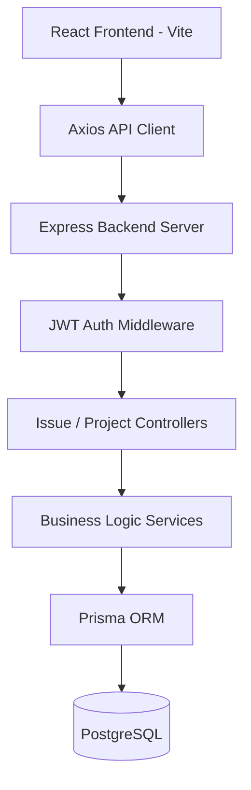

# DevFlow - Deep Dive & Technical Architecture Specification

## 1. Project Overview
DevFlow is a full-stack developer collaboration and project issue tracking platform built with React, Vite, TypeScript, Express, Prisma ORM, PostgreSQL, and Docker.

### Interview Explanations
- **30-Second Pitch**: "DevFlow is a developer collaboration system built with React, TypeScript, Express, Prisma, and PostgreSQL. It manages software projects, issue boards, workflow statuses, team permissions, and real-time activity updates."
- **1-Minute Pitch**: "DevFlow enables agile development teams to track issue lifecycles. The frontend is built using React and Vite with state management via TanStack Query and React Router. The Node.js Express backend uses Prisma ORM for relational PostgreSQL persistence, providing role-based access control for team workspace members."

## 2. Technology Stack
| Technology | Where Used | Why Used | Important Concepts |
|---|---|---|---|
| React & Vite | Frontend | Fast HMR development and component-driven UI | Virtual DOM, Hooks, Context |
| TypeScript | Full Stack | Strict type contracts between API client and backend | Shared DTO types, DTO validation |
| Express & Prisma | Backend API & DB | Type-safe database operations and REST routes | Schema migrations, relational models |
| PostgreSQL | Primary Database | Complex relational project & issue entities | Foreign keys, composite indexes |

## 3. Architecture

## 4. API Endpoints
| Method | Endpoint | Auth | Purpose |
|---|---|---|---|
| `GET` | `/api/projects` | JWT | List workspace projects |
| `POST` | `/api/issues` | JWT | Create new issue ticket |
| `PATCH` | `/api/issues/:id/status` | JWT | Update issue Kanban status |
